<div align="center">

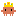

# Clawd Icons

**Every Claude Code agent gets its own mascot.**

39 pixel-art Clawds for Herdr (a crown, a wizard hat, a rubber duck...) that
replace the Claude icon, so you can tell your agents apart at a glance in the
sidebar and the tab bar.

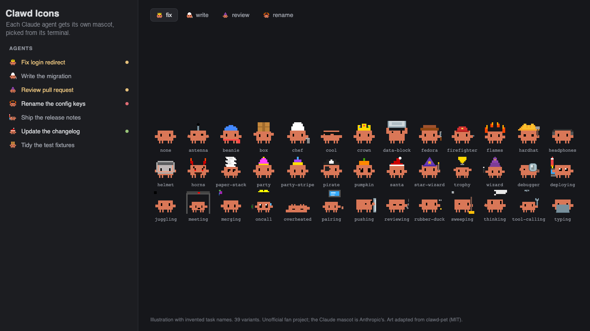

</div>

## Why

In Herdr, every Claude agent shows the same Claude icon. Run five of them and
the sidebar is five identical orange blobs. Clawd Icons gives each one its own
mascot.

## Features

- 39 mascots. Each agent's mascot comes from its terminal address, so it never changes while the terminal lives, even across app restarts.
- Quit Claude and start it again in the same terminal, and the same mascot comes back.
- No mod to run, no settings, no saved state: a folder of SVGs and a 4-line patch.
- Static pixel-art SVGs in Claude orange (`#D97757`), sharp at 14 px and 16 px.

## The cast

<table>
  <tr>
    <td align="center">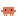<br><sub>none</sub></td>
    <td align="center">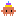<br><sub>party-stripe</sub></td>
    <td align="center">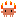<br><sub>flames</sub></td>
    <td align="center">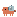<br><sub>debugger</sub></td>
    <td align="center">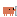<br><sub>pushing</sub></td>
    <td align="center">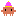<br><sub>party</sub></td>
    <td align="center">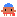<br><sub>beanie</sub></td>
    <td align="center">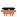<br><sub>cool</sub></td>
  </tr>
  <tr>
    <td align="center">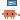<br><sub>pairing</sub></td>
    <td align="center">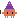<br><sub>wizard</sub></td>
    <td align="center">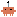<br><sub>antenna</sub></td>
    <td align="center">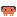<br><sub>headphones</sub></td>
    <td align="center">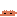<br><sub>overheated</sub></td>
    <td align="center"><br><sub>typing</sub></td>
    <td align="center">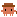<br><sub>fedora</sub></td>
    <td align="center">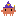<br><sub>star-wizard</sub></td>
  </tr>
  <tr>
    <td align="center">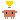<br><sub>trophy</sub></td>
    <td align="center">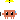<br><sub>oncall</sub></td>
    <td align="center">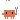<br><sub>tool-calling</sub></td>
    <td align="center">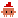<br><sub>santa</sub></td>
    <td align="center">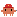<br><sub>firefighter</sub></td>
    <td align="center">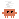<br><sub>paper-stack</sub></td>
    <td align="center">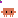<br><sub>merging</sub></td>
    <td align="center">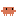<br><sub>thinking</sub></td>
  </tr>
  <tr>
    <td align="center">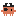<br><sub>pirate</sub></td>
    <td align="center">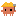<br><sub>hardhat</sub></td>
    <td align="center">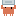<br><sub>data-block</sub></td>
    <td align="center">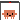<br><sub>meeting</sub></td>
    <td align="center">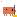<br><sub>sweeping</sub></td>
    <td align="center">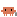<br><sub>chef</sub></td>
    <td align="center">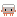<br><sub>helmet</sub></td>
    <td align="center">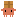<br><sub>box</sub></td>
  </tr>
  <tr>
    <td align="center">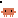<br><sub>juggling</sub></td>
    <td align="center">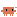<br><sub>rubber-duck</sub></td>
    <td align="center"><br><sub>crown</sub></td>
    <td align="center">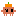<br><sub>pumpkin</sub></td>
    <td align="center">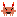<br><sub>horns</sub></td>
    <td align="center">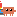<br><sub>deploying</sub></td>
    <td align="center">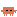<br><sub>reviewing</sub></td>
  </tr>
</table>

## Install

1. Copy the icons into Herdr:

   ```sh
   cp -R mods/clawd-icons ~/.config/herdr-app/mods/
   ```

2. In each mod that shows agent icons, such as your sidebar and tab bar, add
   these lines right before it draws `program.icon`. `address` is the agent's
   terminal address, and `size` is the icon size that mod already uses:

   ```js
   if (program?.key === "claude" && address) {
     const n = [...address].reduce((h, c) => (h * 31 + c.charCodeAt(0)) >>> 0, 0) % 39;
     return image(`mods/clawd-icons/${n}.svg`).w(size).h(size).flex_none();
   }
   ```

3. Check each mod you patched:

   ```sh
   herdr-app check ~/.config/herdr-app/mods/<mod>
   ```

> [!IMPORTANT]
> Herdr restores its shipped mods (`agents`, `tabs`, `spaces`, `pane`) on every
> start. To patch one, clone it with `mod.clone` first and point your layout at
> the clone.

## How it works

Herdr gives every Claude agent the same icon and has no per-agent icon setting.
So the patch replaces the icon in the mods that show it: for a Claude agent, it
turns the terminal address (like `t23`) into a number from 0 to 38 and shows
`mods/clawd-icons/<number>.svg`.

The same address always gives the same number, so an agent keeps its mascot
with nothing stored anywhere.

## Good to know

- Two agents can get the same mascot. Terminals opened one after another usually get different ones.
- If you add or remove a mascot, change the `39` in every patch. That also reshuffles which agent gets which mascot.
- Updating a patched mod overwrites your patch. Add the lines from step 2 again.
- Built on Herdr 0.1.15 (macOS), with Better Sidebar 3.3.0 and Better Tabs 3.0.0 as the patched mods.

## Credits

The art is adapted from [clawd-pet](https://github.com/abderrahimghazali/clawd-pet)
by abderrahimghazali (MIT, see [`LICENSE-clawd-pet.txt`](mods/clawd-icons/LICENSE-clawd-pet.txt)).

Unofficial fan project, not affiliated with or endorsed by Anthropic.
Clawd, the Claude mascot, is Anthropic's character.
