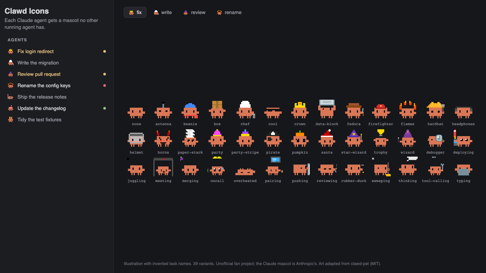

# Clawd Icons

Every Claude Code agent gets its own mascot: a pixel-art variant of the Claude
mascot (a crown, a chef's hat, a wizard hat, a rocket...), picked at random
from the ones no other running agent has. Agents become recognisable at a
glance in the sidebar and the tab bar. The mod only decides who gets which
picture; **it draws nothing itself** (see Watch out).



Unofficial fan project, not affiliated with or endorsed by Anthropic. The
Claude mascot is Anthropic's character. The art is adapted from
[clawd-pet](https://github.com/abderrahimghazali/clawd-pet) (MIT, licence in
`mods/clawd-icons/icons/LICENSE-clawd-pet.txt`).

## What you see

- Nothing from this mod: it sits in a 0 px block.
- In every mod that reads its assignments, a Claude agent's icon is one of
  39 mascot pictures in place of the plain Claude icon, at the size that mod
  already uses (16 px in a sidebar row, 14 px in a tab).
- The 39 variants, all with the body in Claude's orange `#D97757` and black
  eyes: none, crown, chef, pirate, santa, fedora, wizard, party, party-stripe,
  pumpkin, helmet, hardhat, firefighter, star-wizard, antenna, beanie, flames,
  horns, box, data-block, paper-stack, trophy, headphones, cool, and
  working-debugger, -deploying, -juggling, -meeting, -merging, -oncall,
  -overheated, -pairing, -pushing, -reviewing, -rubber-duck, -sweeping,
  -thinking, -tool-calling, -typing.
- Each picture is a static SVG of `<rect>`s on a 1-unit grid,
  `shape-rendering="crispEdges"`, in a square viewBox of 17 to 20 units: the
  mascot is 15 units wide with its feet on the bottom edge, the hat above.

## How it behaves

- Every 1500 ms it looks at every terminal. A terminal running Claude Code
  (`program.key === "claude"`) that has no picture gets one at random from the
  pictures no living terminal has.
- A terminal keeps its picture until it closes, across app restarts. Closing
  the terminal frees the picture.
- A terminal that stops running Claude keeps its picture while it lives, so
  starting Claude there again shows the same mascot.
- With more than 39 Claude terminals, pictures are shared.
- A picture removed from the list is replaced by one that exists.
- Agent status (working, blocked, done, idle) changes nothing here: the mascot
  is the same in every status, and the mod showing it keeps its own status mark.
- No clicks, keys or hovers. Nothing moves.

## Built from

- `mods/clawd-icons/mod.json`: `{ "place": "none", "title": "Clawd Icons" }`.
- `mods/clawd-icons/main.js`: a `View`. `init` calls `look()` and
  `cx.timer.every(1500, () => this.look())`. `look()` reads `terminals()`,
  calls `assign(...)` and, only when it returns a new map, `setShared`.
  `render()` returns an empty `div()`.
- `mods/clawd-icons/assign.js`: `assign(current, live, claude, icons, random)`,
  no imports, returns the next map or `null` when nothing changes.
  `assign.test.mjs` checks it with `node`.
- `mods/clawd-icons/icons.js`: `ICONS`, the 39 names. `icons/<name>.svg`: the
  pictures.
- Herdr functions: `terminals()`, `shared`, `setShared`. No commands, no
  programs, no network, no files outside its folder.
- What it publishes:
  `shared("clawd-icons") = { [terminal address]: "mods/clawd-icons/icons/<name>.svg" }`.
- In the layout, one block as the last child of a column:

  ```json
  { "id": "clawd-icons", "type": "block", "content": { "mod": "clawd-icons" }, "size": { "px": 0 } }
  ```

- In each mod that draws an agent's icon, before it draws `program.icon`
  (`address` is the agent's or the pane's terminal address):

  ```js
  const own = program?.key === "claude" && shared("clawd-icons")?.[address];
  if (own) return image(own).w(size).h(size).flex_none();
  ```

- Art: clawd-pet's SVGs with their `<style>` (the CSS animation), ground
  shadow, `<use>` particles and floating decorations removed, the body colour
  `#DE886D` replaced by `#D97757`, and the viewBox cropped to the mascot and
  its hat.

## Watch out

- **On its own this mod changes nothing on screen.** Herdr takes an agent's
  icon from the program table, so every Claude agent resolves to the same
  "Claude Code" entry, and there is no per-terminal icon. The mascots appear
  only in mods that read `shared("clawd-icons")` with the lines above. Add
  them to whichever mods list agents in the person's layout. Herdr's shipped
  mods (`agents`, `tabs`, `spaces`, `pane`) are restored on every start: clone
  one with `mod.clone` and point the layout at the clone before changing it.
- `"place": "none"` means nothing docks it: without the 0 px block it never
  starts. In a 0 px block it starts but `render()` is not called again, which
  is why it looks on a timer and not in `render()`.
- Draw the mascot only when `program.key === "claude"`: a terminal that went
  back to a shell still has its entry.
- Before herdr-core answers, `terminals()` is empty. Forget nobody then, or
  every agent gets a new mascot on each start.
- Call `setShared` only when the map changed: it re-renders every mod.
- A new agent shows the plain Claude icon for up to 1.5 s.
- Terminals on a machine that goes offline leave `terminals()`, so their
  agents get new mascots when it comes back.
- Updating a patched mod overwrites the patch; the icons fall back to the
  plain one until it is added again.
- Built on Herdr 0.1.15, macOS, with Better Sidebar 3.3.0 and Better Tabs
  3.0.0 as the patched mods.

## Done when

- `node mods/clawd-icons/assign.test.mjs` prints `ok`.
- `herdr-app check ~/.config/herdr-app/mods/clawd-icons` passes and
  `herdr-app status` lists no errors.
- With two or more Claude agents running, `shared.json` has `"clawd-icons"`
  with one entry per Claude terminal, all different, each naming a file that
  exists in `mods/clawd-icons/icons/`.
- Starting a new Claude agent adds an entry within 2 s, different from the
  others, and its icon in a patched mod changes from the plain Claude icon to
  a mascot.
- Closing that terminal removes its entry.
- The window looks the same with and without the 0 px block.
